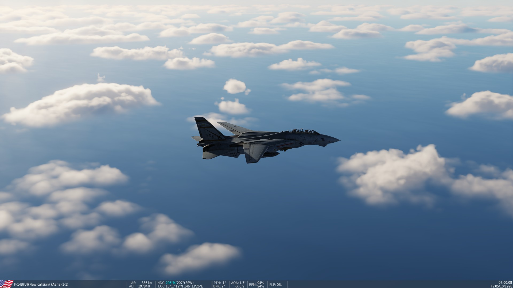
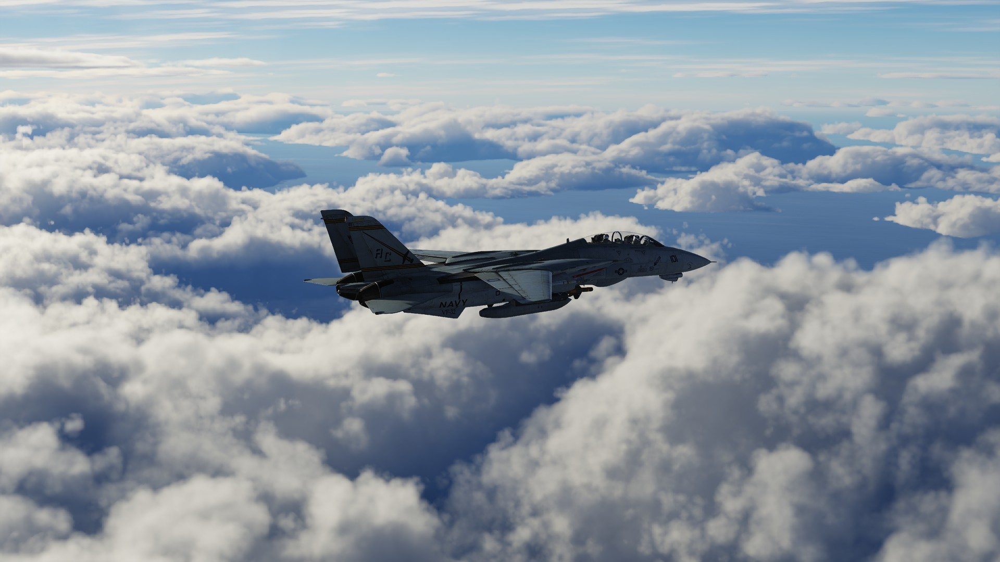

# DCS Fluffy Clouds — weather and cloud overhaul for DCS World

**DCS Fluffy Clouds** is a complete visual weather and cloud overhaul for **DCS World**. It changes the way the simulator draws and presents the sky, clouds, cirrus, precipitation, water, lightning, and related atmospheric effects, with a visual style inspired by Microsoft Flight Simulator.

The package is **standalone**: the ATMOS-X shader and terrain files required by the custom cloud renderer are included inside the mod. You do not need to install or enable ATMOS-X separately.

> **Important:** this mod replaces DCS installation files while enabled. Use a mod manager such as OvGME so every change can be reverted safely. DCS updates may require the mod to be disabled, reviewed, and re-enabled. Multiplayer integrity-check compatibility is not guaranteed.

[Download the complete package](https://github.com/luizcstr/DCS-Fluffy-Clouds/releases/latest) · [License](LICENSE)

## Latest release: v1.0.1

This release is based on the latest `Weather_MSFS_Realista_Standalone` package found locally.

- Updated standalone runtime and cloud-rendering files.
- Preserved the OvGME installation structure.
- **Experimental:** cloud condensation is included as an experimental feature.

## What the mod changes

The mod replaces the default weather-rendering components with one consistent package:

- **Cloud presets:** reworked ATMOS-X presets with adjusted altitude, thickness, density, coverage, detail scale, and cloud-top variation.
- **Cloud coverage:** a smoother coverage map reduces repetitive patterns and produces more natural transitions between cloud areas.
- **Volumetric rendering:** the patched `fxo.edcz` shader cache provides fuller cloud bases, more varied tops, and more defined cloud lobes.
- **Cirrus and sky:** custom cirrus detail, Moon, star, and atmospheric shaders improve the upper-sky layers and distant atmosphere.
- **Weather effects:** rain, snow, water, lightning, smoke, steam, and particle-system shaders are bundled so the package remains visually consistent.
- **Mission Editor:** the included weather-panel files and thumbnails make the custom presets available while creating or editing missions.
- **Runtime support:** `enlight.dll` is included for both standard and multithreaded DCS executables.

## Installation with OvGME

1. Close DCS World.
2. Download the complete ZIP from the [Releases page](https://github.com/luizcstr/DCS-Fluffy-Clouds/releases).
3. Extract the mod folder into the Mods folder used by your OvGME profile.
4. Confirm that the profile's **Root Folder** is the DCS World installation directory, not `Saved Games`.
5. Disable ATMOS-X and any other cloud, weather, or shader mod that overwrites files under `Bazar`, `Config`, `MissionEditor`, `bin`, or `bin-mt`.
6. Enable only `Fluffy Clouds`.
7. Start DCS and allow the first shader rebuild to finish.

If OvGME reports file conflicts, cancel activation and disable the conflicting mod first.

## Reverting

Close DCS and disable `Fluffy Clouds` in OvGME. OvGME restores the original simulator files.

## Before-and-after comparison

| Without the mod | With mod applied |
| --- | --- |
|  |  |

## Credits and license

This is an independent community mod using ATMOS-X-related configuration and custom cloud-rendering work. Microsoft Flight Simulator is referenced only as visual inspiration. This project is not affiliated with Microsoft, Eagle Dynamics, or ATMOS-X.

See [LICENSE](LICENSE) for the repository license.
